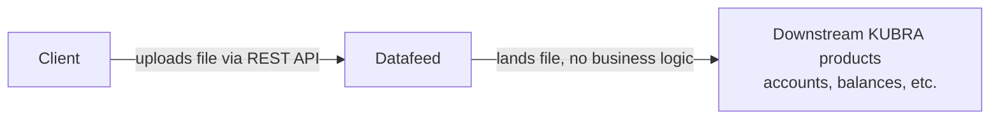
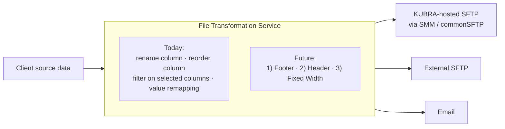

# Platform 1 Priorities — 2026-09-16

## Purpose

Platform 1 builds service-delivery tools — [[Datafeed]], [[File-Transformation-Service]] (FTS), and [[SFTP-Mailbox-Manager]] (SMM) — so Katalyst and Service Delivery can set up a client's file handling themselves, from a UI, in minutes instead of depending on engineering for bespoke per-client configuration. The three products are the building blocks of that self-serve setup, part of [[ConfigHQ]].

## How data moves — inbound vs. outbound

Platform 1's roadmap centers on two data flows: inbound (a client sends KUBRA a file) and outbound (KUBRA sends a client-usable file somewhere). Most current work is on the outbound side.

### Inbound — Datafeed

Datafeed is the ingestion path: a client pushes a file in, and it empowers whatever KUBRA product needs it downstream. Datafeed itself doesn't transform or interpret the file — it just receives and hands off.

### Outbound — destinations + FTS

Destinations are shown left-to-right in the order the team is tackling them: KUBRA-hosted SFTP first, external SFTP second, email last.

## FTS — capabilities today vs. future

| | Capability |
|---|---|
| **Today** | Column rename |
| | Column reorder (drag-drop) |
| | Filtering on selected columns (show/hide) |
| | Value remapping (e.g. a column's raw value `web` → `Web`) |
| **Future** | 1) Footer support |
| | 2) Header support |
| | 3) Fixed-width output |

Footer/Header/Fixed-Width is already tracked as `KUBRA-122` / `FTS-379` — see [[initiatives-epics]] for current status.

## Priorities — status

Mapping the slide's 9 items to where they actually stand, per [[initiatives-epics]]:

### Shipped / working today
- **FTS core transforms** — rename, reorder, filter, value remapping. Confirmed working now.

  **Caveat:** today, remittance and batch post files for the 4 KHQ clients are still delivered to the legacy, manually-configured **DSO-managed KUBRA-hosted SFTP bucket** — separate from Platform 1's own tooling. FTS can already route to a Platform 1-owned "SFTP destination," but simply pointing clients at it would mean migrating each one to a new SFTP location — a significant inconvenience. That's the problem **SMM-1** (SFTP Mailbox Manager) solves: it replaces the DSO-hosted bucket with something that scales to KUBRA's 160+ clients. The migration of the 4 KHQ clients specifically (DSO bucket → SMM) is planned with no lift on the client side, so it can happen without disrupting them — see "Migrate 4 KHQ clients to SMM" below.

### In progress
- **SFTP Mailbox Manager (commonSFTP)** — `KUBRA-118` / `SMM-1`. Platform 1's first Initiative-linked epic; lets Service Delivery self-serve SFTP mailbox creation instead of the manually-configured DSO mailbox.
- **FTS Footer support** — `KUBRA-122` / `FTS-379`.
- **FTS Header support** — `KUBRA-122` / `FTS-379`.
- **FTS Fixed Width support** — `KUBRA-122` / `FTS-379`.

### Not yet started / open
- **Migrate 4 KHQ clients to SMM, keeping current file schemas** — `FTS-370` (Migrate to SFTP Mailbox Manager), status Open. Moves those clients' remittance/batch post files from the DSO-hosted SFTP bucket onto SMM with no lift on the client side — no new credentials, no schema change — so the DSO-hosted bucket can eventually be deprecated without disrupting existing clients.
- **External SFTP destination** — `KUBRA-121` / `FTS-403` / `SMM-70`. Phase 1 of the broader "External Destination" concept; scoped after Team Katalyst found 17 clients need delivery to a client-hosted (not KUBRA-hosted) SFTP.
- **Email destination — sending files to email** — `KUBRA-181` / `FTS-439`. Phase 2 of "External Destination," explicitly not yet scoped.
- **Aggregate-level reports (sent via email)** — separate from the file-to-email destination above; no Jira ticket identified yet for this specifically, worth confirming whether it's covered under `FTS-439` or needs its own epic.

### Back burner / future
- **Datafeed Status**
- **Inbound File Transformation**

## Open questions

- The slide marks **Datafeed Status** as back-burner, but [[initiatives-epics]] shows related work (`DF-1362` File Statuses, `DF-1418` KHQ Datafeed Status integration) already **In Progress**. Worth confirming with the team whether the slide's prioritization is stale, or whether that Jira work is unrelated to what "Datafeed Status" means on the slide.
- **External SFTP** (`KUBRA-121`) is scoped; **Email** (`KUBRA-181`) explicitly isn't yet — including whether email delivery needs any SMM-owned work at all, or is entirely FTS/reporting-side. Revisit once Phase 1 (SFTP) is further along.
- **Inbound File Transformation** has no matching epic yet in [[initiatives-epics]] — it's back-burner enough that it may not be worth scoping until the outbound work above lands.
